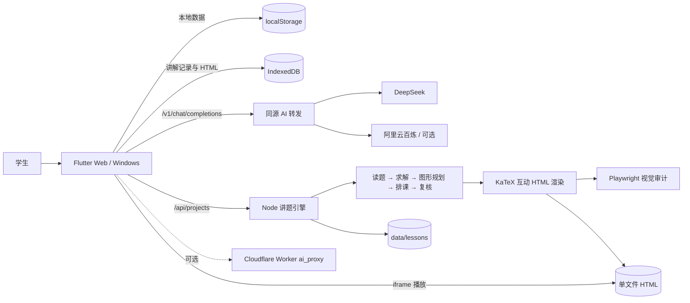

# 格数至理 · geshu-math

> 把“看答案”变成“真正学会”的 AI 数学学习工作台。

格数至理是一个面向初高中学生的 AI 数学答疑与学习分析应用。学生可以拍照、粘贴文字或上传文档提交数学题，获得结构化错因分析、完整解答、分步讲解、知识点回顾和变式训练；学习结果会自动沉淀到错题本、学习报告、学生画像和知识图谱中。

前端使用 Flutter，同时支持 Web 与 Windows 桌面；本地 Node.js 服务负责讲题引擎、模型转发和互动讲解生成；模型侧兼容 OpenAI `chat/completions` 协议，可通过配置切换服务商与模型。


> 🏆 **CCNU 第一届黑客松参赛项目**<br>
> 参赛目标：在 2026-10-23 至 2026-10-25 的开发窗口内，完成一个可运行、可演示、可持续迭代的 AI 数学学习产品。

---

## 目录

- [产品亮点](#产品亮点)
- [功能总览](#功能总览)
- [使用流程与示例](#使用流程与示例)
- [系统架构](#系统架构)
- [技术栈](#技术栈)
- [快速开始](#快速开始)
- [完整运行教程](#完整运行教程)
- [配置说明](#配置说明)
- [API 与自动化示例](#api-与自动化示例)
- [数学讲解引擎](#数学讲解引擎)
- [数据存储与安全](#数据存储与安全)
- [测试与质量验证](#测试与质量验证)
- [常见问题](#常见问题)
- [目录结构](#目录结构)
- [已知限制](#已知限制)
- [许可证](#许可证)

---

## 产品亮点

### 1. 不是只给答案，而是定位错因

错题指导采用「错因 → 正解 → 分步解析 → 思路来源 → 易错警示 → 知识点回顾 → 变式训练」的学习闭环。支持快速版和专家版：

- **快速版**：一问一答，流式输出，适合日常快速订正。
- **专家版**：通过决策树多轮追问，先定位学生卡点，再逐步讲解。
- 完成后自动保存到错题本，并记录错因与学习轨迹。

### 2. 从“看懂”到“会做”

错题本不只是题目列表，还支持掌握度、收藏、标签、难度和模块筛选；可回看完整解析、生成互动讲解、导出 PDF，并用变式训练继续巩固。

### 3. 老师式互动黑板

讲题引擎会把解答加工成包含读题、关键变形、推导、检验和结论的互动讲解：

- 逐场景推进，支持播放、暂停、重讲、跳转和全屏。
- 浏览器中文语音朗读，跟随系统语音包。
- 公式使用内嵌 KaTeX 离线排版。
- 支持图形与矢量板书，并进行视觉布局审计。
- 生成单文件 HTML，可离线播放和下载。

> 当前“讲解视频”指可交互的 HTML 讲解播放器，**不输出 MP4**。

### 4. 学习数据自动汇总结论

- 学习报告：近 7 / 30 / 90 天统计、AI 复习建议、重点练习推荐。
- 学生画像：掌握度、薄弱知识点、错因分布、连续学习天数和反复错误。
- 知识图谱：333 个知识点节点，三层结构，可旋转浏览，也可切换知识树；支持按掌握度显示弱点热力视图。

### 5. 本地优先、可替换模型

- 统一启动器同时托管前端、讲题引擎和 AI 转发：默认 `http://127.0.0.1:8124`。
- 真实 Key 只放服务端 `.env.local`，统一启动时不会写入前端静态配置。
- 支持 DeepSeek、阿里云百炼或任意 OpenAI 兼容接口。
- 可选 Cloudflare Worker 网关，用于公网部署时隐藏 Key。

---

## 功能总览

| 模块 | 主要能力 |
|---|---|
| 首页概览 | 学习工具宫格、掌握度统计环、最近错题、继续学习入口 |
| 错题指导 | 快速版 / 专家版、多轮追问、流式回答、图片与文字题目、会话恢复 |
| 错题本 | 掌握度、收藏、标签、难度、模块筛选、排序、解析详情、删除、PDF 导出 |
| 拍照识题 | 本地图片选择、OCR 与多模态双通道、低质量 OCR 自动回退 |
| 考试分析 | 试卷图片识别、模块得分统计、AI 考情报告、历史记录 |
| 智能问答 | 多轮数学问答、流式输出、推荐问题 |
| 学习报告 | 7 / 30 / 90 天统计、复习建议、练习推荐、报告缓存 |
| 学生画像 | KPI、能力与错因统计、薄弱点自述、AI 画像解读 |
| 数学讲解 | 文字 / 图片 / 文档生成互动 HTML，播放、历史、下载 |
| 知识图谱 | 333 节点三层图谱、旋转、缩放、知识树浏览、掌握度弱点热力 |
| 模型设置 | 快速 / 推理 / 视觉三类角色独立配置与真实连通性检测 |
| 运行诊断 | 持久启动日志、引擎崩溃日志、可操作的服务断开提示 |

---

## 使用流程与示例

### 示例 A：错题指导

1. 打开首页，进入「错题指导」。
2. 粘贴题目，或上传题目图片。
3. 选择「快速版」或「专家版」并提交。
4. 阅读七段式订正结果。
5. 在底部继续追问、点击「完成，问下一题」，或从讲解入口生成互动讲解。
6. 结果自动进入错题本，并计入学习报告与学生画像。

示例题干：

```text
已知函数 f(x)=x^3-3x+1，求 f(x) 在区间 [-2,2] 上的最大值和最小值。
```

### 示例 B：直接生成数学讲解

1. 首页进入「数学讲解」。
2. 输入题干：

```text
实数 $a,b$ 满足 $\frac{1}{a^3}e^{a^2-b}+2a^2=6\ln a+2b+1$，
$c\in\mathbb{R}$，求 $(a-c)^2+(b+c)^2$ 的最小值。
```

3. 也可以同时上传题图或 PDF / DOCX / TXT 文档。
4. 页面会先显示数学预览，可切换「编辑题干」查看原始文本。
5. 点击「生成数学讲解」，等待读题、求解、排课、复核和视觉检查。
6. 生成完成后可播放、暂停、逐步回看或下载单文件 HTML。

### 示例 C：考试与学习报告

1. 上传试卷图片进行识别。
2. 查看按模块统计的得分与 AI 分析。
3. 打开「学习报告」，查看近 7 / 30 / 90 天学习趋势。
4. 进入「学生画像」，查看薄弱知识点与错因分布。

---

## 系统架构



关键设计：

- **同源优先**：默认统一启动，前端和后端共享 `127.0.0.1:8124`，减少 CORS 与端口错配。
- **角色化模型**：快速、推理、视觉模型可分别选择服务商。
- **内容复核**：求解与讲稿复核分离，发现争议时只重排讲稿，必要时才重新求解。
- **视觉守卫**：生成后由 Playwright 检查布局、越界和元素重叠，并支持自动修复。
- **离线公式**：KaTeX CSS、JS 与字体全部内嵌，下载后的 HTML 不依赖外部 CDN。
- **可恢复任务**：任务状态持久化；页面刷新或短时断网后可继续查询。

---

## 技术栈

| 层 | 技术 |
|---|---|
| 前端 | Flutter、Riverpod、go_router |
| 网络 | Dio、SSE 流式解析、OpenAI 兼容协议 |
| 富文本 | flutter_markdown、markdown、KaTeX |
| 图表 | fl_chart |
| 文档 | PDF / printing、file_picker、image_picker |
| 后端 | Node.js 20+、Fastify、TypeScript、tsx |
| 视觉检查 | Playwright Core + Microsoft Edge |
| AI | DeepSeek；可选阿里云百炼；任意 OpenAI 兼容服务 |
| 测试 | Flutter Test、Vitest、Node Test、Playwright |

---

## 快速开始

### Windows 一键启动（推荐）

1. 安装 **Node.js ≥ 20** 和 **Flutter ≥ 3.29**。
2. 确保 Chrome 或 Microsoft Edge 可用。
3. 克隆仓库并进入目录：

```powershell
git clone https://github.com/411pur/geshu-math.git
cd geshu-math
```

4. 复制配置模板：

```powershell
Copy-Item .env.example .env.local
Copy-Item local.config.example.json local.config.json
```

5. 编辑 `.env.local`：

```dotenv
DEEPSEEK_API_KEY=你的_key
ALIYUN_API_KEY=
```

6. 双击根目录的 `启动项目.bat`，或运行：

```powershell
node tool/start.mjs
```

浏览器缓存导致旧页面反复出现时，双击 `清理缓存.bat`。它会清理构建缓存与 Chrome / Edge 的 Service Worker / HTTP 缓存，但不会清理错题、成绩、画像和讲解数据。

7. 打开终端输出中的地址，默认是：

```text
http://127.0.0.1:8124
```

首次启动会自动：

- 安装 `lesson_engine` 依赖；
- 检查或构建 `build/web`；
- 生成无密钥的 `build/web/config.json`；
- 启动讲题引擎、AI 转发和静态前端；
- 将日志写入 `build/local-stack-logs/lesson-engine.<时间>.log`。

修改配置后，先在启动窗口按 `Ctrl+C`，再重新启动。已有实例运行时，启动器不会重复启动或杀掉其他项目。

---

## 完整运行教程

### 1. 环境要求

| 软件 | 最低版本 | 检查命令 |
|---|---:|---|
| Node.js | 20 | `node --version` |
| npm | 10+ | `npm --version` |
| Flutter | 3.29 | `flutter --version` |
| Dart | 3.8 | `dart --version` |
| Chrome / Edge | 最新稳定版 | 浏览器可正常启动即可 |

### 2. 安装依赖

```powershell
flutter pub get

Set-Location lesson_engine
npm ci --no-audit --no-fund
Set-Location ..
```

### 3. 配置模型

最小可用配置：

```dotenv
DEEPSEEK_API_KEY=<your-deepseek-key>
```

`local.config.json` 示例：

```json
{
  "host": "127.0.0.1",
  "port": 8124,
  "dataDir": "data/lessons",
  "model": "deepseek-flash",
  "visionModel": "deepseek-flash",
  "reasoningModel": "deepseek-v4-pro",
  "fastProvider": "deepseek",
  "reasoningProvider": "deepseek",
  "visionProvider": "auto",
  "apiBaseUrl": "https://api.deepseek.com",
  "buildWeb": true,
  "requestTimeoutMs": 180000,
  "maxImageBytes": 12582912,
  "maxDocumentBytes": 12582912
}
```

### 4. 构建前端

```powershell
flutter build web --release --no-web-resources-cdn --no-pub
```

`--no-web-resources-cdn` 会把 Web 运行时资源一起打包，避免国内网络拉取 CDN 导致白屏。

如果已构建过且只修改了服务端配置，可把 `buildWeb` 改为 `false`，启动更快。

### 5. 启动服务

```powershell
node tool/start.mjs
```

健康检查：

```powershell
Invoke-RestMethod http://127.0.0.1:8124/api/health
```

预期返回：

```json
{
  "ok": true,
  "service": "geshu-math",
  "providers": {
    "deepseek": true,
    "aliyun": false,
    "fast": "deepseek",
    "reasoning": "deepseek",
    "vision": "deepseek"
  }
}
```

### 6. 构建 Windows 桌面版（可选）

```powershell
flutter build windows
```

桌面版主要复用 Flutter UI；数学互动讲解仍建议在浏览器中播放。

### 7. 停止服务

- 「启动项目.bat」窗口：按 `Ctrl+C`。
- PowerShell 前台运行：按 `Ctrl+C`。
- 不要直接结束其他项目的 Node 进程。

---

## 配置说明

### `.env.local`

| 变量 | 必填 | 说明 |
|---|---|---|
| `DEEPSEEK_API_KEY` | 使用 DeepSeek 时必填 | 服务端读取，不进入前端静态配置 |
| `ALIYUN_API_KEY` | 可选 | 阿里云百炼 Key；留空时视觉角色会回退 DeepSeek |

`.env.local`、`local.config.json` 和 `web/config.json` 都已加入 `.gitignore`。

### `local.config.json`

| 字段 | 说明 |
|---|---|
| `host` / `port` | 本地服务监听地址，默认 `127.0.0.1:8124` |
| `dataDir` | 讲解任务和生成产物目录 |
| `model` | 快速模型 |
| `reasoningModel` | 推理模型 |
| `visionModel` | 视觉模型 |
| `fastProvider` / `reasoningProvider` / `visionProvider` | `deepseek`、`aliyun` 或 `auto` |
| `apiBaseUrl` | 上游 OpenAI 兼容接口地址 |
| `buildWeb` | 启动前是否自动构建 Flutter Web |
| `requestTimeoutMs` | 模型请求超时 |
| `maxImageBytes` / `maxDocumentBytes` | 上传大小上限 |

### 模型角色

- **快速模型**：读题、排课、内容复核、布局修复。
- **推理模型**：独立求解、答案核对和高难推导。
- **视觉模型**：题图识别、图形重建和视觉复核。

三类模型可以来自不同服务商。页面「我的 → 设置 → 模型设置」可查看实际服务来源并执行连接测试。

---

## API 与自动化示例

所有接口默认位于 `http://127.0.0.1:8124`。

### 健康检查

```powershell
Invoke-RestMethod http://127.0.0.1:8124/api/health
```

### 创建讲解任务

```powershell
$response = Invoke-RestMethod `
  -Method Post `
  -Uri http://127.0.0.1:8124/api/projects `
  -Form @{
    text = '已知函数 f(x)=x^2-4x+3，求它的最小值。'
  }

$response.id
```

### 查询任务

```powershell
Invoke-RestMethod "http://127.0.0.1:8124/api/projects/$($response.id)"
```

### 订阅进度事件

```powershell
curl.exe -N "http://127.0.0.1:8124/api/projects/$($response.id)/events"
```

### 打开或下载 HTML

```text
http://127.0.0.1:8124/api/projects/<项目ID>/html
http://127.0.0.1:8124/api/projects/<项目ID>/download
```

### 主要接口

| 方法 | 路径 | 用途 |
|---|---|---|
| `GET` | `/api/health` | 服务、模型与服务商状态 |
| `POST` | `/api/projects` | 创建讲解任务 |
| `GET` | `/api/projects` | 任务列表 |
| `GET` | `/api/projects/:id` | 任务详情与进度 |
| `GET` | `/api/projects/:id/events` | SSE 进度事件 |
| `POST` | `/api/projects/:id/regenerate` | 重新生成 |
| `GET` | `/api/projects/:id/html` | 预览互动讲解 |
| `GET` | `/api/projects/:id/download` | 下载单文件 HTML |
| `POST` | `/api/extract-text` | 从 PDF / DOCX / TXT 提取题目文字 |
| `POST` | `/v1/chat/completions` | 同源 AI 转发 |

---

## 数学讲解引擎

讲解引擎位于 [`lesson_engine/`](lesson_engine/README.md)，采用异步任务：

```text
读题
  → 独立求解
  → 图形规划
  → 讲解排课
  → 内容复核
  → 互动 HTML 渲染
  → Playwright 视觉检查
  → 必要时自动修复
```

生成产物：

```text
data/lessons/<项目ID>/
├── meta.json
├── problem.json
├── solution.json
├── lesson.json
├── verification.json
├── index.html
└── visual/
```

生成后的 HTML：

- 内嵌 KaTeX 与字体，可离线显示公式；
- 使用浏览器语音朗读；
- 自动翻页，也可手动控制；
- 支持全屏、重讲和场景跳转；
- 通过 iframe 嵌入 Flutter 播放器。

常用命令：

```powershell
Set-Location lesson_engine
npm test
npm run build
npm start
```

### 可选 AI 网关

`ai_proxy/` 是 Cloudflare Worker，适合公网部署：

- 隐藏真实 API Key；
- 按 `X-Board` 注入服务端提示词；
- 限制模型白名单；
- 透传 SSE。

详见 [`ai_proxy/README.md`](ai_proxy/README.md)。

---

## 数据存储与安全

### 浏览器数据

| 数据 | 存储 |
|---|---|
| 错题、考试记录、单题详情 | `localStorage` |
| 学习报告缓存、画像缓存、会话记录 | `localStorage` |
| 互动讲解记录与 HTML | `IndexedDB` |
| 模型界面偏好 | `localStorage` |

清除浏览器站点数据会清空本地学习记录。

### 服务端数据

- 讲解任务与产物保存在 `data/lessons/`；
- 日志保存在 `build/local-stack-logs/`；
- 这些目录均不入 Git。

### 密钥安全

- 统一启动时，真实 Key 只在 Node 服务端读取；
- 前端收到的是同源转发地址和占位 Key；
- 不要把真实 Key 写进 `web/config.json`、源码、截图或 README；
- 公网部署请使用 `ai_proxy` 或等价的反向代理。

---

## 测试与质量验证

### Flutter

```powershell
flutter test
flutter analyze
flutter build web --release --no-web-resources-cdn --no-pub
```

### 讲题引擎

```powershell
Set-Location lesson_engine
npm test
npm run build
Set-Location ..
```

### 启动日志

```powershell
node --test tool\run-log.test.mjs
```

### 当前验证基线

截至 2026-10-25：

- Flutter 测试：47 项通过；
- 讲题引擎测试：170 项通过，2 项按环境跳过；
- `flutter analyze`：无问题；
- TypeScript 编译：通过；
- Flutter Web Release：构建通过；
- Node 启动日志测试：通过；\n- 从 GitHub 干净克隆后重新安装依赖、执行测试与编译：通过。

实际测试数量会随功能增加而变化，以 CI / 本地最新输出为准。

---

## 常见问题

### 页面提示“讲题引擎未运行”或 `Failed to fetch`

说明前端在，但本地引擎不可达。双击项目根目录的 `启动项目.bat`，等待终端出现：

```text
格数至理已启动：http://127.0.0.1:8124
```

然后刷新页面。日志位于：

```text
build/local-stack-logs/lesson-engine.<时间>.log
```

### `/api/health` 中 `providers.deepseek` 为 `false`

检查根目录 `.env.local` 是否填写 `DEEPSEEK_API_KEY`，然后关闭原启动窗口并重新运行。

### 改了配置但没有生效

统一启动器只在启动时加载配置。按 `Ctrl+C` 停止原实例，再运行 `启动项目.bat`。

### 浏览器仍显示旧界面

Flutter Service Worker 可能缓存旧构建。使用 `Ctrl+Shift+R` 强制刷新，或双击 `清理缓存.bat`。清理脚本不会删除浏览器 localStorage 中的学习数据。

### 上传 PDF 后没有文字

扫描件或纯图片 PDF 没有文本层，请改用「上传图片」。

### 没有语音

互动讲解使用浏览器 / 操作系统语音包。请在系统中安装中文语音，并确认浏览器未静音。

### 生成为什么不是 MP4？

当前版本输出的是可交互单文件 HTML，支持语音、自动翻页和板书。MP4 导出与 TTS 音频合成不在当前范围内。

---

## 目录结构

```text
geshu-math/
├── lib/                         # Flutter 应用
│   ├── core/                    # 主题、网络、SSE、JSON 容错、Settings
│   ├── data/                    # localStorage 数据源与仓库
│   ├── domain/                  # 错题、考试、知识节点实体
│   ├── features/
│   │   ├── home/                # 首页、导航、设置
│   │   ├── wrong_question/      # 错题指导与错题本
│   │   ├── lesson_studio/       # 数学讲解生成、播放与历史
│   │   ├── exam/                # 考试分析
│   │   ├── qa/                  # 智能问答
│   │   ├── report/              # 学习报告与学生画像
│   │   ├── knowledge/           # 知识图谱与知识树
│   │   └── scan/                # 拍照识题
│   └── shared/                  # Markdown、通用组件、工具
├── lesson_engine/               # Node.js 讲题引擎
│   ├── src/
│   │   ├── ai/                  # DeepSeek / 阿里云客户端与提示词
│   │   ├── pipeline/            # 读题、求解、排课、复核
│   │   ├── render/              # 互动 HTML 与 KaTeX 渲染
│   │   ├── visual/              # 图形审计与修复
│   │   ├── store/               # 项目与产物存储
│   │   └── server.ts            # Fastify API
│   └── tests/                   # Vitest / Playwright 测试
├── ai_proxy/                    # 可选 Cloudflare Worker 网关
├── assets/knowledge/            # 333 节点知识图谱数据
├── test/                        # Flutter 测试
├── tool/                        # 统一启动器、运行日志与缓存清理脚本
├── web/                         # Flutter Web 入口与配置样例
├── windows/                     # Windows runner
├── docs/                        # 迁移与补充文档
├── 启动项目.bat                 # Windows 一键启动
└── README.md
```

---

## 已知限制

- 以本地单机演示为主，没有账号体系、云端同步和多端协同。
- 本地数据依赖浏览器存储，清理站点数据后不可恢复。
- AI 生成内容仍可能出错，答案应由教师或学生二次核验。
- Flutter 页面内的公式使用轻量 TeX→Unicode 转换；完整排版以互动讲解 HTML 为准。
- 浏览器语音依赖操作系统语音包。
- 当前不导出 MP4，不提供云端视频转码队列。
- 项目尚未声明开源许可证，默认保留所有权利。

---

## 许可证

当前仓库未声明开源许可证，默认保留所有权利。

项目内使用的第三方组件遵循各自许可证，包括但不限于 Flutter、Fastify、KaTeX、Dio、Playwright 和 Cloudflare Workers 工具链。若计划将本项目作为开源模板长期维护，建议在公开发布前增加合适的 `LICENSE` 文件。
